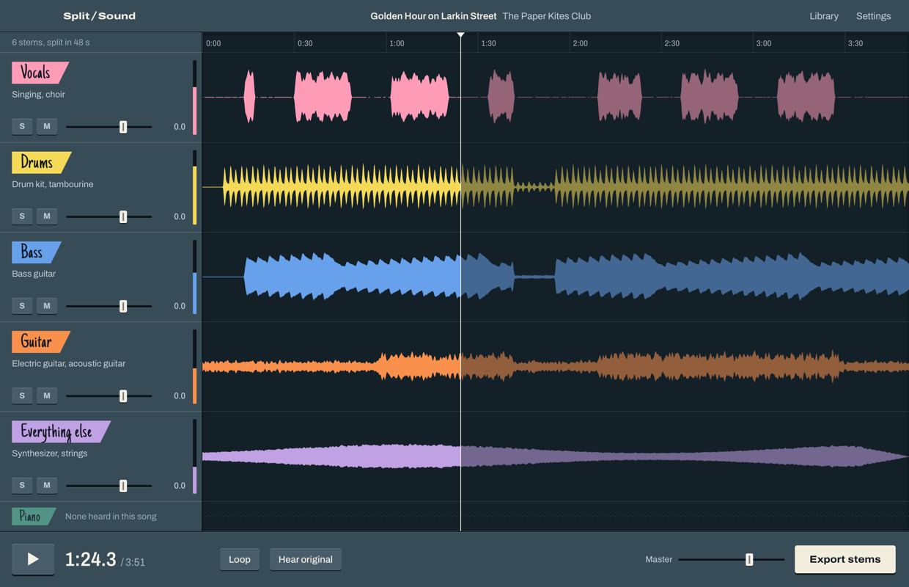

# SplitSound

Desktop app for separating songs into vocals, drums, bass, guitar, piano, and other stems locally on your machine.



## Features

- Opens MP3, WAV, FLAC, Opus, OGG, M4A/AAC, ALAC, and AIFF files.
- Scans imported tracks to detect which instruments are present and suggests a split mode.
- Splits into 2 stems (vocals and instrumental), 4 stems (vocals, drums, bass, other), or 6 stems (adds guitar and piano).
- Three quality levels: **Fast** (SCNet small), **Best** (SCNet large), and **Studio** (isolates vocals with Mel-Band RoFormer first to cut vocal bleed, then splits the remaining instruments).
- Built-in playback mixer with per-stem gain, mute, solo, section looping, and quick comparison against the original track.
- Exports individual stems or a custom mixdown to WAV (16-bit, 24-bit, or 32-bit float), FLAC, or MP3, or lets you drag stems straight into a DAW.
- Keeps split songs in a local library until you remove them.


## Download

Grab the installer for your platform from the [latest release](https://github.com/Omaaarkhan/splitsound/releases/latest).

| Platform | Installer |
| --- | --- |
| macOS 14+ (Apple silicon) | `SplitSound_<version>_macos-arm64.dmg` |
| Windows 10 / 11 (64-bit) | `SplitSound_<version>_windows-x64-setup.exe` |
| Linux (64-bit) | `.AppImage`, `.deb`, or `.rpm` |

Installers are not signed with an Apple or Microsoft developer certificate yet, so the first launch takes one extra step:

- **macOS:** open the app once, then go to System Settings > Privacy & Security and click "Open Anyway".
- **Windows:** on the SmartScreen prompt, click "More info" and then "Run anyway".

Release downloads can be verified against `SHA256SUMS.txt` on the release page (see [SECURITY.md](SECURITY.md#verifying-a-download)).

Intel Macs are not supported because prebuilt ONNX Runtime binaries are no longer published for macOS x86_64.

New releases go out on Fridays whenever changes have landed. The app checks for updates and installs signed updates in-app.

## Models

SplitSound runs local ONNX models through [ONNX Runtime](https://onnxruntime.ai). Each model downloads the first time you pick a mode or quality that needs it and is cached on disk afterward.

| Model | Role | Download | Weights license |
| --- | --- | --- | --- |
| [SCNet](https://github.com/starrytong/SCNet) small | Fast quality (vocals, drums, bass, other) | ~20 MB | MIT |
| SCNet large | Best quality, plus backing stems in Studio | ~78 MB | MIT |
| [Mel-Band RoFormer Vocals](https://github.com/KimberleyJensen/Mel-Band-Roformer-Vocal-Model) | Studio vocal isolation | ~422 MB | MIT |
| [EfficientAT](https://github.com/fschmid56/EfficientAT) | Instrument detection | ~19 MB | MIT |
| [Demucs](https://github.com/facebookresearch/demucs) 6-stem | Guitar and piano | ~55 MB (from Meta) | Not open source |

**Studio quality** runs Mel-Band RoFormer first to pull the vocals out of the mix, then hands the remaining audio to SCNet large for drums and bass (and Demucs 6-stem for guitar and piano in 6-stem mode). It is a much bigger download and runs slower than Best, but it cuts down vocal bleed into the backing stems noticeably.

**Demucs 6-stem** is the only practical open model for separating guitar and piano, but Meta distributes its weights for research rather than under an open-source license (likely non-commercial). SplitSound does not bundle or redistribute those weights. If you run a 6-stem split, the app asks for confirmation, downloads the original checkpoint straight from Meta, and converts it locally. Two-stem and four-stem splits work without it.

Full license sources and training-data notes are in [ml/LICENSES.md](ml/LICENSES.md).

### Separation quality and speed

Measured on the 50 test excerpts of the MUSDB18 7-second sample set (median SDR in dB, higher is better):

| Quality | Vocals | Drums | Bass | Other |
| --- | --- | --- | --- | --- |
| Studio (Mel-Band RoFormer + SCNet large) | 11.6 | 10.5 | 9.1 | 7.4 |
| Best (SCNet large) | 10.7 | 10.3 | 8.6 | 7.1 |
| Fast (SCNet small) | 9.5 | 9.7 | 8.5 | 6.0 |

Two caveats on the Studio row: the training data for KimberleyJensen's checkpoint is not documented (so it may include MUSDB18 tracks), and these excerpts are 7-second AAC clips rather than full MUSDB18-HQ tracks. See [ml/BENCHMARKS.md](ml/BENCHMARKS.md) for the full measurements.

On an Apple M4, a four-minute song takes roughly 30 seconds in Fast, about 2 minutes in Best, and around 5 to 8 minutes in Studio depending on the split mode.

## Privacy and security

SplitSound does not use accounts, cloud processing, or telemetry. Network access is limited to fetching models and update metadata from GitHub, plus Meta's download host if you opt into Demucs 6-stem. Every model file is checked against a pinned SHA-256 hash before loading, audio files are decoded with memory-safe Rust decoders, and the frontend only accesses local files through a fixed set of IPC commands. See [SECURITY.md](SECURITY.md) and [docs/architecture.md](docs/architecture.md#security-model) for details.

## Building from source

Requires [Rust](https://rustup.rs) (the toolchain in `rust-toolchain.toml` is picked up automatically), [Node.js](https://nodejs.org) 24+, and on Linux the [Tauri system libraries](https://tauri.app/start/prerequisites/) plus `libasound2-dev`.

```sh
npm ci
node scripts/fetch-onnxruntime.mjs   # downloads pinned ONNX Runtime build
npm run tauri dev                    # run the desktop app
npm run tauri build                  # build an installer for this platform
```

You can also run the UI in a regular browser against a built-in mock backend with `npm run dev`.

```sh
npm run lint && npm run typecheck && npm test   # frontend checks
cargo test --workspace                          # Rust engine and app tests
cargo run --release -p splitsound-cli -- separate song.mp3 --mode band --quality studio
```

More docs:

- [crates/splitsound-core/README.md](crates/splitsound-core/README.md): Rust separation engine and CLI
- [docs/architecture.md](docs/architecture.md): overall architecture and security model
- [docs/design.md](docs/design.md): UI design notes
- [ml/README.md](ml/README.md): ONNX export, verification, and benchmark scripts

## Credits

Built with [SCNet](https://github.com/starrytong/SCNet) (Weinan Tong et al.), [Mel-Band RoFormer](https://github.com/KimberleyJensen/Mel-Band-Roformer-Vocal-Model) (KimberleyJensen, [ZFTurbo/Music-Source-Separation-Training](https://github.com/ZFTurbo/Music-Source-Separation-Training), and [lucidrains/BS-RoFormer](https://github.com/lucidrains/BS-RoFormer)), [Demucs](https://github.com/facebookresearch/demucs) (Simon Rouard, Francisco Massa, and Alexandre Défossez / Meta), [EfficientAT](https://github.com/fschmid56/EfficientAT) (Florian Schmid et al.), [ONNX Runtime](https://onnxruntime.ai), [Symphonia](https://github.com/pdeljanov/Symphonia), and [Tauri](https://tauri.app). Fonts are [Archivo](https://fonts.google.com/specimen/Archivo) and [Just Another Hand](https://fonts.google.com/specimen/Just+Another+Hand).

## License

Code is licensed under the [MIT License](LICENSE). Third-party dependency notices are in [THIRD-PARTY.md](THIRD-PARTY.md), and model weights follow their respective licenses listed above.
