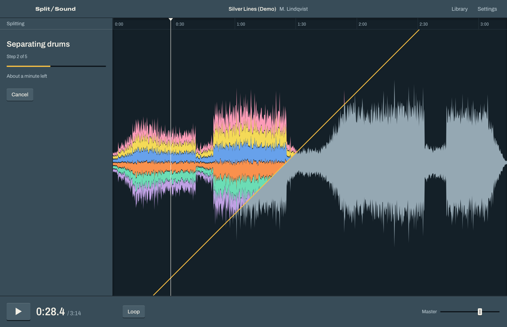

# SplitSound

Split any song into vocals, drums, bass, guitar, piano and everything else,
on your own computer. Nothing is uploaded.


## What it does

- **Opens what you have.** MP3, WAV, FLAC, Opus, OGG, M4A/AAC, ALAC and AIFF.
- **Hears what is in the song.** After you open a song it listens for a few
  seconds and tells you which instruments it found, then suggests how to
  split it.
- **Splits three ways.** Vocals and backing track (2 stems), band (vocals,
  drums, bass, other), or every instrument (adds guitar and piano).
- **Lets you listen before you keep anything.** Solo, mute and balance each
  stem, loop a section, and flip back to the original to compare.
- **Gets stems out easily.** Export as WAV (16, 24 or 32-bit float), FLAC or
  MP3, or drag a stem's label straight into your DAW.
- **Keeps a library.** Songs you split stay available until you remove them.



## Download

Get the installer for your system from the
[latest release](https://github.com/Omaaarkhan/splitsound/releases/latest).

| System | File |
| --- | --- |
| macOS 14 or newer (Apple silicon) | `SplitSound_<version>_macos-arm64.dmg` |
| Windows 10 and 11 (64-bit) | `SplitSound_<version>_windows-x64-setup.exe` |
| Linux (64-bit) | `.AppImage`, `.deb` or `.rpm` |

The app is not yet signed with an Apple or Microsoft certificate, so the
first launch needs one extra step:

- **macOS:** open the app once, then go to System Settings, Privacy &
  Security, and choose "Open Anyway".
- **Windows:** on the SmartScreen prompt choose "More info", then "Run anyway".

You can check a download against `SHA256SUMS.txt` from the same release; see
[SECURITY.md](SECURITY.md#verifying-a-download).

Intel Macs are not supported, because the inference runtime is no longer
published for them.

A new version is released every Friday when something has changed. The app
checks for updates and offers to install them; updates are signed.

## The models

SplitSound runs open models through [ONNX Runtime](https://onnxruntime.ai).
They are downloaded the first time they are needed and kept on your computer.

| Model | Used for | Download | Licence of the weights |
| --- | --- | --- | --- |
| [SCNet](https://github.com/starrytong/SCNet) small | vocals, drums, bass, other (Fast) | 20 MB | MIT |
| SCNet large | the same, more cleanly (Best) | 78 MB | MIT |
| [EfficientAT](https://github.com/fschmid56/EfficientAT) | naming the instruments | 19 MB | MIT |
| [Demucs](https://github.com/facebookresearch/demucs) 6-stem | guitar and piano | 55 MB, from Meta | **Not open source** |

**About Demucs.** It is the only practical model for separating guitar and
piano, but Meta publishes its weights for research, not under an open-source
licence, and they are probably limited to non-commercial use. SplitSound
therefore does not include or redistribute them. If you choose "Every
instrument", the app asks first, then downloads the original file directly
from Meta and prepares it on your computer. Everything else works without it.

Where every licence claim comes from, and what is known about the training
data, is written down in [ml/LICENSES.md](ml/LICENSES.md).

How well it separates, measured on the 50 test songs of the MUSDB18 sample
set (median signal-to-distortion ratio, higher is better):

| | vocals | drums | bass | other |
| --- | --- | --- | --- | --- |
| Best (SCNet large) | 10.7 dB | 10.3 dB | 8.6 dB | 7.1 dB |
| Fast (SCNet small) | 9.5 dB | 9.7 dB | 8.5 dB | 6.0 dB |

On an Apple M4, a four-minute song takes about half a minute in Fast and
about two minutes in Best.

## Privacy and security

No account, no telemetry. The app contacts GitHub to download its models and
check for updates, and Meta's download server only if you add the Demucs
model. Models are pinned by SHA-256 and refused if they do not match; audio
files are decoded by memory-safe code; the interface cannot touch your files
except through a fixed set of checked commands. The details are in
[SECURITY.md](SECURITY.md) and
[docs/architecture.md](docs/architecture.md#security-model).

## Building from source

You need [Rust](https://rustup.rs) (the version in `rust-toolchain.toml` is
picked up automatically), [Node.js](https://nodejs.org) 24 or newer, and on
Linux the [Tauri system libraries](https://tauri.app/start/prerequisites/)
plus `libasound2-dev`.

```sh
npm ci
node scripts/fetch-onnxruntime.mjs   # Microsoft's official build, pinned and verified
npm run tauri dev                    # run the app
npm run tauri build                  # build an installer for this system
```

The interface also runs in a browser against a built-in mock, which is handy
for design work: `npm run dev`, then open the address it prints.

```sh
npm run lint && npm run typecheck && npm test   # interface
cargo test --workspace                          # engine and app shell
cargo run --release -p splitsound-cli -- separate song.mp3 --mode band
```

The engine is a plain Rust library with a command-line tool; see
[crates/splitsound-core/README.md](crates/splitsound-core/README.md). How the
pieces fit together is in [docs/architecture.md](docs/architecture.md), and
the look of the app is specified in [docs/design.md](docs/design.md). The
models are exported to ONNX by the scripts in [ml/](ml/README.md).

## Thanks

SplitSound stands on [SCNet](https://github.com/starrytong/SCNet) by Weinan
Tong and colleagues, [Demucs](https://github.com/facebookresearch/demucs) by
Simon Rouard, Francisco Massa and Alexandre Défossez at Meta,
[EfficientAT](https://github.com/fschmid56/EfficientAT) by Florian Schmid and
colleagues, [ONNX Runtime](https://onnxruntime.ai) by Microsoft,
[Symphonia](https://github.com/pdeljanov/Symphonia) and
[Tauri](https://tauri.app). The typefaces are
[Archivo](https://fonts.google.com/specimen/Archivo) by Omnibus-Type and
[Just Another Hand](https://fonts.google.com/specimen/Just+Another+Hand) by
Astigmatic.

## Licence

The code is [MIT](LICENSE). Third-party components keep their own licences,
listed in [THIRD-PARTY.md](THIRD-PARTY.md). The models are licensed
separately, as described above.
